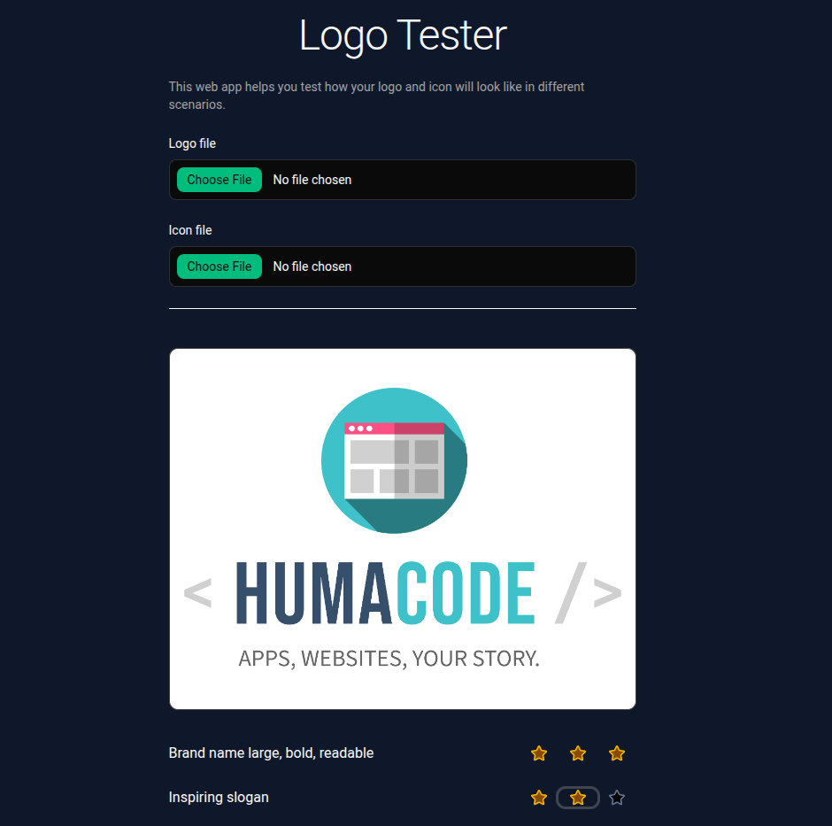

# Logo Tester

[](https://github.com/Shuunen/logo-tester/blob/master/LICENSE)
[](https://hits.sh/github.com/Shuunen/logo-tester/)


> Check how your logo and icon hold up in the scenarios that matter : light, dark, grayscale, inverted, small, as an app icon, next to famous brands.

## Usage

Upload a logo and an icon, scroll through the scenarios, rate each criteria, then copy the results to your clipboard as a tab-separated line ready to paste into a spreadsheet.



## Development

```bash
pnpm install
pnpm dev     # start the dev server
pnpm check   # types, formatting, lint, build, unit & e2e tests
```

## Thanks

- [Boxy Svg](https://boxy-svg.com) : simple & effective svg editor
- [Bun](https://bun.sh) : super fast runtime for JavaScript and TypeScript
- [Github](https://github.com) : for all their great work year after year, pushing OSS forward
- [Knip](https://github.com/webpro/knip) : super tool to find & fix problems
- [Oxc](https://oxc.rs) : a lovely super-fast collection of JavaScript tools written in Rust
- [Oxlint](https://oxc.rs) : fast linter
- [Radix UI](https://www.radix-ui.com) : unstyled accessible primitives
- [React](https://react.dev) : ui library
- [Shields.io](https://shields.io) : for the nice badges on top of this readme
- [Shuutils](https://github.com/Shuunen/shuutils) : collection of pure JS utils
- [Svg Omg](https://jakearchibald.github.io/svgomg/) : the great king of svg file size reduction
- [Tailwind](https://tailwindcss.com) : utility-first CSS framework
- [TailwindCss](https://tailwindcss.com) : awesome lib to produce maintainable style
- [V8](https://github.com/demurgos/v8-coverage) : simple & effective cli for code coverage
- [Vite](https://vite.dev) : super fast frontend tooling
- [Vitest](https://vitest.dev) : super fast unit testing
